# roblox-sky-render

A Claude skill that turns anything in a Roblox place into a clean, transparent-background image.
It drives Roblox Studio through the Studio MCP server, using only viewport screenshots. You don't
need a plugin.

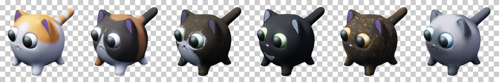

## Quick install

**Paste this into Claude Code:**

```text
Install the Claude skill from https://github.com/Wh1msicaly/roblox-sky-render by cloning it into my
personal skills folder as roblox-sky-render (~/.claude/skills/roblox-sky-render, or
%USERPROFILE%\.claude\skills\roblox-sky-render on Windows). If that folder already exists, pull
instead of cloning. Then confirm SKILL.md is there.
```

**Or run it yourself (macOS / Linux / Git Bash):**

```bash
git clone https://github.com/Wh1msicaly/roblox-sky-render ~/.claude/skills/roblox-sky-render
```

**Windows PowerShell:**

```powershell
git clone https://github.com/Wh1msicaly/roblox-sky-render "$env:USERPROFILE\.claude\skills\roblox-sky-render"
```

Start a new Claude Code session afterwards so the skill gets picked up. To update it later, run
`git pull` in that folder.

> [!NOTE]
> **Run this skill on Claude Haiku 5.5.** It's significantly faster, and rendering follows a fixed,
> scripted procedure, so it doesn't need a larger model like Opus 5.5, which is meant for coding and
> more complex tasks. Switch before you ask for a render:
>
> ```text
> /model claude-haiku-5-5
> ```
>
> In the desktop app you can pick Haiku 5.5 in the model picker instead. If you start the skill on
> another model, Claude will ask you to switch first. Say so if you'd rather stay on your current
> model, and it will carry on.

## What you need

- **Claude Haiku 5.5** as the active model (see the note above).
- **Roblox Studio** with its MCP server connected to Claude. The skill uses the `execute_luau`
  and `screen_capture` tools.
- Studio in **Edit** mode (not a playtest), with the 3D viewport visible and not minimised.
- Studio's Graphics Mode must not be OpenGL, because screenshots don't work in that mode.
- **Python 3**, only if you want PNG files saved to disk. No extra packages are needed.

## Using it

Ask Claude in plain words. For example:

> Render all of the cat squishies in the Cats model under Workspace.

> Make a shop icon for ReplicatedStorage.Items.BananaSword, looking at it from the front.

Claude finds the item, renders it, checks each result on a preview board in the sky, then asks
how you want the images delivered.

## Example: six tools in one batch

These came from one request in a real place. The six cat squishy Tools under `Workspace.Cats` were
rendered in a single batch call with default settings, at 512×512 each.

**Before:** the six cats as they sit in the place in Studio, surrounded by buildings, lights and
everything else in the map.

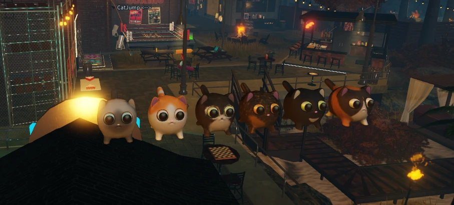

**After:** each one cut out cleanly on its own, with the map gone. Below, each render is shown over magenta and over dark grey. This is the same check the skill does
before delivering. Clean edges on both backgrounds mean the alpha is right.

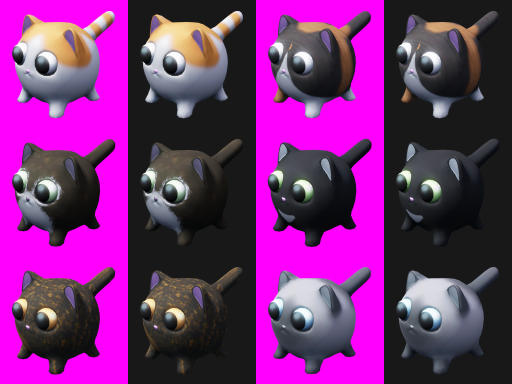

| | | |
|:-:|:-:|:-:|
|  |  | 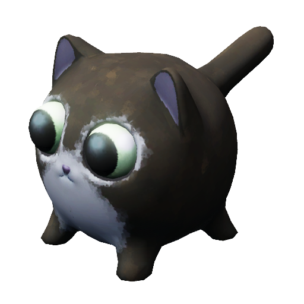 |
| ButtersSquishy | BeanSquishy | SavannahSquishy |
|  | 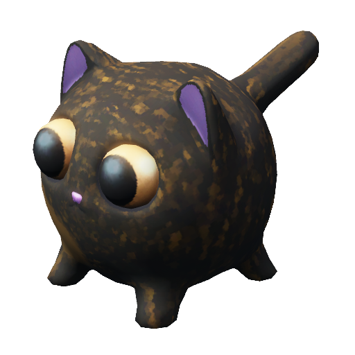 |  |
| BinxSquishy | MeowMeowSquishy | SageSquishy |

Every render reported a clean backdrop calibration (white 255, black 0). Each item was about 41%
opaque with under 1% semi-transparent edge pixels, and nothing was clipped at the image edges.

## How it works

Roblox can't render with a transparent background, so the skill measures transparency instead:

1. It clones the item and lifts the clone into empty sky, so buildings, terrain and shadows can't
   get in the way. The original is never moved.
2. It photographs the clone in front of a flat **black** backdrop, then a flat **white** one.
3. For each pixel, a change from black to white means background, no change means solid item, and
   anything in between is partly see-through (glass, soft edges).
4. A third shot with the place's own bloom and colour correction supplies the final colour.

While it shoots, it also sets up studio lighting, turns off fog, clouds, blur, particles and
Studio's selection overlays, and stops the Neon backdrop from glowing over thin parts. Everything
it changes is put back afterwards, even if a render fails.

The full method, all the options (camera angle, field of view, size, padding, lighting, particles
and more) and a troubleshooting table are in [SKILL.md](SKILL.md).

## Saving PNG files

### Default: no setup

Saving the images as PNGs works out of the box in Claude Code, with no Studio permissions to change.

Studio can only hand back text, and each `execute_luau` result is cut off at 100,000 characters.
But when a result is too big to show, Claude Code saves it straight to a file. The exporter uses
that:

1. **Compress in Studio.** Each pixel is stored as its difference from the one to its left, which
   turns smooth shading into near-zeros. Then LZW compression, then packing into 7-bit characters,
   since all 128 ASCII characters survive the trip.
2. **Send fixed-size pieces.** Each piece is just under the 100,000-character limit, so Claude Code
   always saves it to a file. Claude never reads or copies the data, so nothing can get garbled.
3. **Rebuild on your PC.** `scripts/assemble_png.py` finds the saved pieces, checks each one,
   decodes them and writes the PNGs. It uses only Python's standard library, so there's nothing
   to install.

| Six 512×512 cat renders | Characters | `execute_luau` calls |
|---|---|---|
| Plain base64 of the raw pixels | 8,388,624 | 84 |
| **Filter + LZW + 7-bit characters** | **1,047,469** | **12** |

That's about 8× smaller. All six came back pixel-identical to the HTTP export, confirmed with
checksums on every piece and on the final pixels.

### Fallback: HTTP

If your Claude client cuts off large results instead of saving them, the skill falls back to the
original method. Studio sends the pixels to a small local receiver (`scripts/png_receiver.py`) at
`127.0.0.1:8765`. This needs one Studio permission first, or the export fails with:

```text
HttpService request denied: domain 127.0.0.1:8765 is not in the Assistant HTTP allowlist
```

You only need to set this up once, and only for the fallback. If the export gets blocked, Claude
will stop and walk you through these steps.

**1. In Studio's Assistant panel, open the ⋯ menu at the top right.**

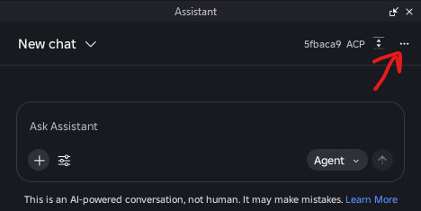

**2. Choose Settings.**

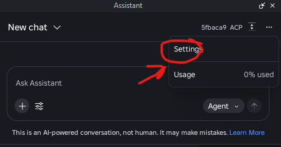

**3. Select MCP Permissions.**

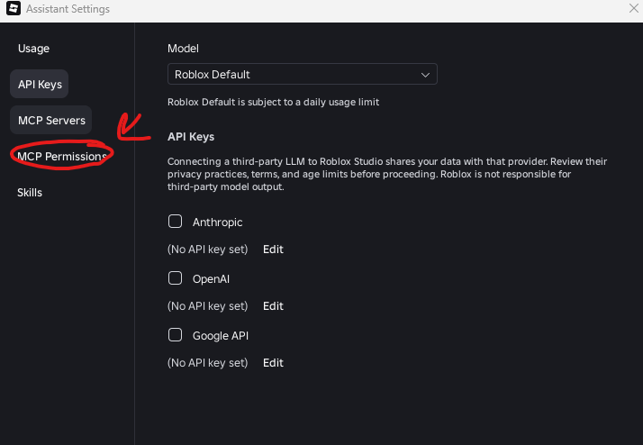

**4. Set "Connect to the internet" to Allow, then expand its capabilities.**

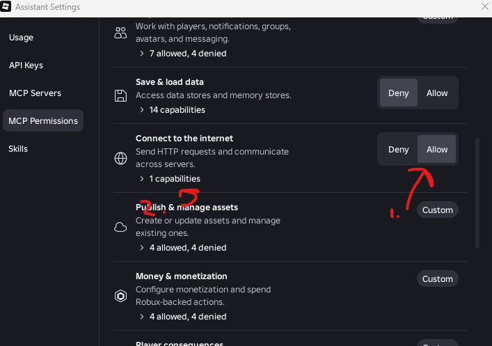

**5. Under "HTTP domain allow list", enter `127.0.0.1:8765` and click Add.**

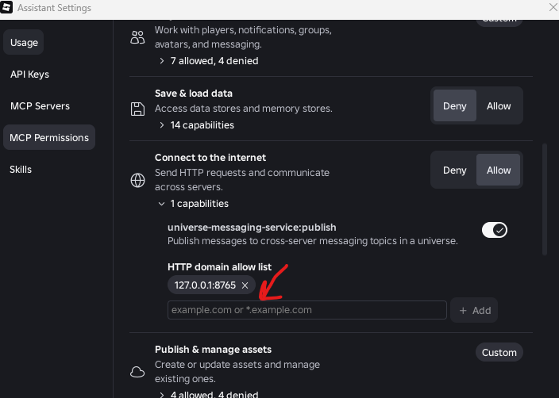

**6. Scroll down and click Save.**

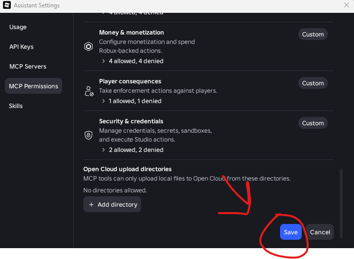

Then tell Claude to retry the export. If you run the receiver on a different port, allow that
address instead.

## Files

| Path | What it is |
|---|---|
| `SKILL.md` | The instructions Claude follows. |
| `scripts/render_item.luau` | The renderer. Pasted into Studio once per session. |
| `scripts/export_nohttp.luau` | Compresses renders and returns them in fixed-size pieces (default export). |
| `scripts/assemble_png.py` | Rebuilds the PNGs from the saved pieces. Standard library only. |
| `scripts/export_png.luau` | HTTP fallback: sends finished renders to the local receiver. |
| `scripts/png_receiver.py` | HTTP fallback: localhost-only receiver that writes the PNG files. |
| `images/` | Screenshots for the HTTP allow list steps. |
| `examples/` | The renders shown above. |
